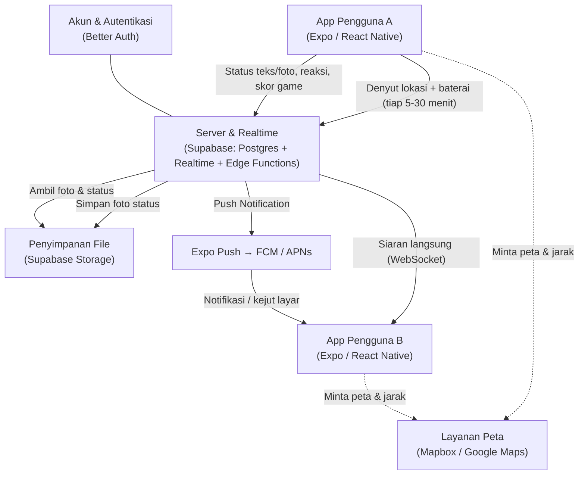
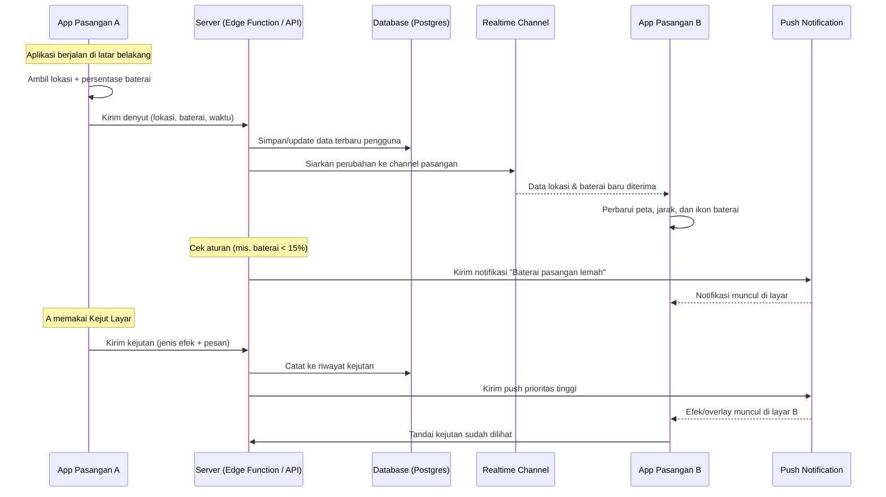
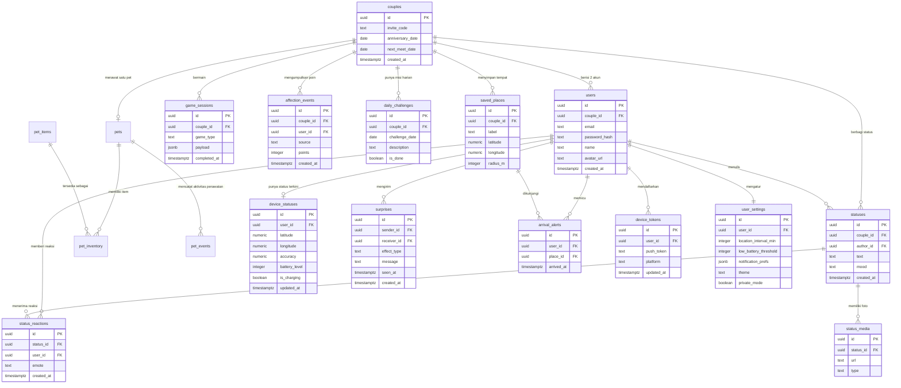

# PRD — Project Requirements Document

## 1. Overview

**Latar belakang masalah**
Kami sedang menjalani hubungan jarak jauh (LDR). Komunikasi sehari-hari lewat chat biasa terasa kurang: tidak tahu pasangan sedang di mana, apakah HP-nya masih ada baterai, atau bagaimana suasana hatinya hari ini. Aplikasi couple yang ada di pasaran (seperti Love8) bersifat publik, penuh iklan, dan datanya bercampur dengan banyak pengguna lain — rasanya tidak privat untuk hal seintim ini.

**Solusi**
Aplikasi privat berdua saja — hanya dua akun yang saling terhubung, tidak ada pengguna lain, tidak ada feed publik. Semua fitur dirancang untuk satu tujuan: membuat pasangan LDR tetap terasa dekat setiap hari.

**Tujuan utama**
1. **Menghadirkan rasa "ada"** — pasangan bisa melihat lokasi, baterai, dan status terbaru kapan saja tanpa harus bertanya.
2. **Menghubungkan lewat momen kecil** — status teks/gambar, reaksi, dan kejutan lucu yang langsung muncul di layar pasangan.
3. **Memberi alasan untuk dibuka tiap hari** — hitungan hari bersama, tantangan harian, dan mini games yang menambah poin afeksi.
4. **Menjaga privasi sepenuhnya** — data lokasi dan baterai hanya boleh dilihat oleh pasangan, tidak ada pihak ketiga.

**Ukuran keberhasilan**
- Kedua pasangan membuka aplikasi minimal sekali sehari.
- Info lokasi & baterai selalu ter-update (tidak basi lebih dari beberapa menit).
- Ada interaksi (status, reaksi, game, atau kejutan) setiap hari.

---

## 2. Requirements

**Persyaratan fungsional**
- Aplikasi **hanya untuk 2 pengguna** yang saling terhubung lewat kode undangan. Tidak ada pendaftaran terbuka atau pengguna lain.
- Info **lokasi live** dan **baterai pasangan** diperbarui otomatis di latar belakang, tanpa perlu membuka aplikasi.
- **Status berdua** mendukung teks, gambar, emoji suasana hati, dan balasan dari pasangan.
- **Kejut layar** harus benar-benar muncul di layar pasangan (overlay/notifikasi penuh) dalam hitungan detik.
- **Mini games** bersifat asinkron — bisa dimainkan kapan saja, tidak harus berbarengan.
- **Papan skor afeksi** menghitung poin dari semua aktivitas berdua.

**Persyaratan non-fungsional**
- **Hemat baterai** — interval pengiriman lokasi bisa diatur (misal 5–30 menit) dan otomatis melambat saat baterai lemah.
- **Privat & aman** — data hanya bisa diakses oleh dua akun tersebut; lokasi tidak pernah disimpan lebih lama dari yang diperlukan (riwayat dibatasi, misalnya 30 hari).
- **Izin jelas** — aplikasi meminta izin lokasi, baterai, dan notifikasi dengan penjelasan ramah, bukan langsung memaksa.
- **Tahan koneksi buruk** — data yang gagal terkirim disimpan sementara lalu dikirim saat internet kembali.
- **Lintas perangkat** — berjalan mulus di Android dan iOS.
- **Biaya murah** — cukup untuk 2 pengguna, jadi bisa memakai paket gratis/rendah dari layanan yang dipilih.

---

## 3. Core Features

Fitur di bawah ini **persis mengikuti roadmap yang sudah disetujui**, dikelompokkan per fase.

### Fase 1 — Beranda Pasangan `[high]`
Layar utama yang menampilkan sekilas keadaan pasangan dan momen kebersamaan kalian.
- **Ringkasan Pasangan** — Lihat posisi, baterai, dan status terbaru pasangan dalam satu layar.
- **Hitungan Hari Bersama** — Jumlah hari sejak kalian resmi bersama, dihitung otomatis.
- **Hitung Mundur Ketemu** — Perkiraan jarak kalian dan hitung mundur menuju pertemuan berikutnya.
- **Sapaan Romantis** — Pesan manis yang berganti sendiri sesuai waktu dan suasana.
- **Together For** — Penghitung kebersamaan yang menampilkan total hari, jam, dan menit sejak tanggal jadian, lengkap dengan lencana milestone (100 hari, 500 hari, 1 tahun, dst.). Melengkapi **Hitungan Hari Bersama** dengan rincian waktu dan perayaan momen.

### Fase 2 — Kehadiran Sehari-hari `[high]`
- **Lokasi Live**
  - **Peta Lokasi Pasangan** — Lihat titik lokasi pasangan bergerak di peta secara langsung.
  - **Jarak Antar Kita** — Tahu berapa jauh jarak dan arah antara kamu dan pasangan.
  - **Kabar Sampai Tujuan** — Dapat pemberitahuan saat pasangan sudah tiba di tempat tujuan.
  - **Tempat Favorit** — Simpan tempat penting seperti rumah, kampus, atau kantor.
- **Baterai Pasangan**
  - **Indikator Baterai** — Lihat persentase baterai HP pasangan saat ini.
  - **Status Pengisian** — Tahu apakah pasangan sedang mengecas atau tidak.
  - **Peringatan Baterai Lemah** — Dapat notifikasi saat baterai pasangan hampir habis.
  - **Terakhir Diperbarui** — Tahu kapan informasi baterai terakhir dikirim pasangan.
- **Status Berdua**
  - **Tulis Status** — Tulis kegiatan atau perasaan singkat untuk pasangan.
  - **Unggah Foto** — Bagikan momen lewat gambar langsung dari aplikasi.
  - **Reaksi Pasangan** — Pasangan bisa membalas status dengan emote atau komentar manis.
  - **Emoji Suasana Hati** — Tandai mood hari ini supaya pasangan tahu perasaanmu.
  - **Riwayat Status** — Lihat lagi semua status yang pernah kalian bagikan.

### Fase 3 — Keseruan Berdua `[medium]`
- **Mini Games Afeksi**
  - **Spam Emote Love** — Kirim banyak emote cinta sekaligus ke pasangan.
  - **Kuis Pasangan** — Tanya-jawab seru untuk menguji seberapa kenal kalian berdua.
  - **Tantangan Harian** — Misi kecil berdua yang berganti setiap hari.
  - **Papan Skor Afeksi** — Kumpulkan poin kebersamaan dari setiap permainan.
- **Kejut Layar**
  - **Kirim Kejutan** — Munculkan pesan atau efek lucu langsung di layar pasangan.
  - **Pilih Jenis Efek** — Pilih hujan hati, getaran, atau suara khusus sebagai kejutan.
  - **Ucapan Cepat** — Kirim kalimat manis yang sudah disiapkan hanya dengan satu sentuhan.
  - **Riwayat Kejutan** — Lihat kejutan yang pernah kalian kirim dan terima.

### Fase 4 — Sambung Pasangan `[high]`
Menghubungkan akunmu dengan akun pasangan supaya hanya kalian berdua yang terhubung.
- **Daftar Akun** — Buat akun pribadi untuk masuk ke aplikasi.
- **Kode Undangan** — Hubungkan akun dengan pasangan memakai kode unik.
- **Masuk & Keluar** — Masuk dan keluar dari akun dengan aman.
- **Verifikasi Perangkat** — Pastikan hanya perangkat kalian yang bisa mengakses.
- **Lupa Sandi** — Pulihkan akses akun kalau lupa kata sandi.

### Fase 5 — Pengaturan & Privasi `[low]`
Atur tampilan, izin, dan privasi aplikasi sesuai kenyamanan kalian berdua.
- **Profil Berdua** — Atur nama, foto, dan tanggal jadian kalian.
- **Izin Lokasi & Baterai** — Atur seberapa sering info lokasi dan baterai dikirim.
- **Mode Privat** — Kunci aplikasi supaya hanya kalian yang bisa membukanya.
- **Pilih Notifikasi** — Tentukan kabar apa saja yang ingin kalian terima.
- **Tema Tampilan** — Ganti warna dan suasana tampilan aplikasi.

### Fase 6 — Pet Berdua `[medium]`
Rawat hewan peliharaan virtual yang kalian besarkan bersama — satu pet untuk berdua, jadi alasan kecil untuk mampir tiap hari.
- **Pelihara Pet** — Adopsi dan rawat satu pet virtual milik kalian berdua; kebutuhannya (lapar, mood, energi, kebersihan) berubah seiring waktu dan dijaga bergantian.
  - **Pilih Bentuk Pet** — Pilih spesies/bentuk pet (mis. kucing, anjing, kelinci) saat adopsi.
  - **Nama & Ulang Tahun Pet** — Beri nama pet dan tentukan tanggal lahirnya agar umurnya bisa dihitung dan dirayakan.
  - **Zodiak Pet** — Zodiak otomatis dari tanggal lahir pet, dipakai untuk kepribadian dan lucu-lucuan.
  - **Status & Level Pet** — Level, pengalaman, dan kondisi pet yang naik saat dirawat rutin.
  - **Toko Pet** — Belanja makanan, mainan, dan item perawatan memakai koin yang dikumpulkan berdua.
  - **Game Pet** — Mini game khas pet (memberi makan, memandikan, bermain, melatih trik) yang menambah koin dan poin afeksi.
  - **Riwayat Perawatan** — Lihat siapa yang terakhir merawat dan apa yang dilakukan, supaya bisa bergantian.

---

## 4. User Flow

> Catatan: urutan di bawah mengikuti urutan fase rilis di roadmap. Secara teknis, fitur **Sambung Pasangan** (Fase 4) dibangun lebih dulu karena menjadi pintu masuk, tetapi baru dirilis setelah Fase 1–3 siap.

**Fase 1 — Pertama kali membuka aplikasi**
1. Pengguna membuka aplikasi dan langsung melihat **Beranda Pasangan**.
2. Di bagian atas tampil **Ringkasan Pasangan**: titik lokasi, persentase baterai, dan status terbaru.
3. Di bawahnya ada kartu **Hitungan Hari Bersama** dan **Hitung Mundur Ketemu**.
4. Pengguna disambut **Sapaan Romantis** yang berubah sesuai jam (pagi/siang/malam).

**Fase 2 — Menjalani hari berdua**
1. Pengguna membuka tab **Lokasi Live** → melihat peta dan titik pasangan bergerak.
2. Di bawah peta muncul jarak & arah, serta daftar **Tempat Favorit** (rumah, kampus, kantor).
3. Saat pasangan tiba di salah satu tempat favorit, muncul **Kabar Sampai Tujuan**.
4. Pengguna membuka tab **Baterai Pasangan** → melihat persentase, status mengecas, dan waktu terakhir diperbarui.
5. Jika baterai pasangan di bawah ambang tertentu, muncul **Peringatan Baterai Lemah**.
6. Pengguna membuka tab **Status Berdua** → menulis status, memilih **Emoji Suasana Hati**, dan mengunggah foto.
7. Pasangan menerima notifikasi, membuka status, dan memberi **Reaksi Pasangan**.
8. Semua status tersimpan dan bisa dibuka lagi lewat **Riwayat Status**.

**Fase 3 — Bermain dan memberi kejutan**
1. Pengguna membuka tab **Mini Games Afeksi**.
2. Memilih **Spam Emote Love** → menekan tombol berulang kali → emote terbang ke layar pasangan.
3. Memainkan **Kuis Pasangan** atau menyelesaikan **Tantangan Harian**.
4. Poin dari setiap permainan masuk ke **Papan Skor Afeksi**.
5. Pengguna membuka **Kejut Layar** → memilih **Jenis Efek** (hujan hati, getaran, suara).
6. Menekan **Ucapan Cepat** untuk mengirim kalimat manis dalam satu sentuhan.
7. Pesan/efek langsung muncul di layar pasangan; keduanya bisa melihat **Riwayat Kejutan**.

**Fase 4 — Menyambungkan akun**
1. Pengguna membuka aplikasi → **Daftar Akun** dengan email & kata sandi.
2. Setelah masuk (**Masuk & Keluar**), aplikasi menampilkan **Kode Undangan** unik.
3. Kode dikirim ke pasangan; pasangan memasukkan kode tersebut.
4. Kedua akun kini terhubung; **Verifikasi Perangkat** memastikan hanya HP kalian yang bisa mengakses.
5. Jika lupa kata sandi, pengguna memakai **Lupa Sandi** untuk memulihkan akses.

**Fase 5 — Mengatur kenyamanan**
1. Pengguna membuka **Profil Berdua** → mengisi nama, foto, dan tanggal jadian.
2. Mengatur **Izin Lokasi & Baterai** (misal update tiap 15 menit, atau lebih hemat saat baterai lemah).
3. Menyalakan **Mode Privat** agar aplikasi minta PIN/sidik jari saat dibuka.
4. Memilih lewat **Pilih Notifikasi** kabar apa saja yang ingin diterima.
5. Mengganti suasana lewat **Tema Tampilan**.

**Fase 6 — Merawat pet berdua**
1. Pengguna membuka tab **Pelihara Pet** → memilih **Pilih Bentuk Pet** lalu menamai pet.
2. Mengisi tanggal lahir pet; **Zodiak Pet** muncul otomatis.
3. Pengguna melihat **Status & Level Pet** (lapar, mood, energi) dan merawatnya.
4. Membuka **Toko Pet** untuk membeli makanan/mainan memakai koin.
5. Bermain **Game Pet** untuk menambah koin & poin afeksi.
6. Keduanya mengecek siapa yang terakhir merawat lewat **Riwayat Perawatan**.

---

## 5. Architecture

**Gambaran singkat sistem**

Aplikasi terdiri dari tiga lapisan sederhana:
1. **Aplikasi mobile** (Android & iOS) — tempat pengguna melihat semua informasi, mengirim status, dan bermain game. Aplikasi ini juga bertugas mengirim "denyut" lokasi & baterai ke server secara berkala di latar belakang.
2. **Server + realtime + penyimpanan** — menerima denyut tersebut, menyimpannya, lalu menyiarkannya langsung ke HP pasangan. Juga menyimpan foto status dan data game.
3. **Layanan notifikasi & peta** — mengirim push notification (baterai lemah, kabar sampai tujuan, kejutan layar) dan menyediakan peta.

**Alur sistem (flow)**

**Alur detail: dari HP A sampai muncul di HP B (sequence)**

**Prinsip penting**
- Semua komunikasi antar HP hanya lewat server; HP tidak pernah saling terhubung langsung.
- Data lokasi disimpan sebagai **data terbaru (1 baris per pengguna)** yang terus ditimpa, sehingga ringan dan hemat.
- Interval pengiriman denyut bisa diatur pengguna, dan otomatis melambat saat baterai lemah.

---

## 6. Database Schema

Struktur data dirancang sederhana: satu "ruang berdua" (couple) yang berisi dua akun pengguna.

**Daftar tabel & field utama**

#### `users` — akun masing-masing pasangan
| Kolom | Tipe | Kegunaan |
|---|---|---|
| id | uuid (PK) | Identitas unik pengguna |
| couple_id | uuid (FK) | Ruang berdua yang diikuti |
| email | text | Untuk masuk akun |
| password_hash | text | Kata sandi terenkripsi (Better Auth) |
| name | text | Nama panggilan |
| avatar_url | text | Foto profil |
| device_verified_at | timestamptz | Penanda verifikasi perangkat |
| created_at | timestamptz | Waktu akun dibuat |

#### `couples` — ruang berdua kalian
| Kolom | Tipe | Kegunaan |
|---|---|---|
| id | uuid (PK) | Identitas ruang berdua |
| invite_code | text | Kode undangan untuk menyambungkan pasangan |
| anniversary_date | date | Tanggal jadian (dasar Hitungan Hari Bersama) |
| next_meet_date | date | Tanggal rencana pertemuan berikutnya |
| created_at | timestamptz | Waktu ruang dibuat |

#### `device_statuses` — lokasi & baterai terbaru (1 baris per pengguna)
| Kolom | Tipe | Kegunaan |
|---|---|---|
| id | uuid (PK) | Identitas baris |
| user_id | uuid (FK) | Milik siapa |
| latitude | numeric | Titik lokasi (lintang) |
| longitude | numeric | Titik lokasi (bujur) |
| accuracy | numeric | Tingkat ketelitian lokasi |
| battery_level | integer | Persentase baterai (0–100) |
| is_charging | boolean | Sedang mengecas atau tidak |
| updated_at | timestamptz | "Terakhir Diperbarui" |

#### `saved_places` — tempat favorit
| Kolom | Tipe | Kegunaan |
|---|---|---|
| id | uuid (PK) | Identitas tempat |
| couple_id | uuid (FK) | Milik ruang berdua |
| label | text | Nama tempat (Rumah, Kampus, Kantor) |
| latitude / longitude | numeric | Koordinat tempat |
| radius_m | integer | Radius deteksi "sudah sampai" |

#### `arrival_alerts` — kabar sampai tujuan
| Kolom | Tipe | Kegunaan |
|---|---|---|
| id | uuid (PK) | Identitas kejadian |
| user_id | uuid (FK) | Siapa yang tiba |
| place_id | uuid (FK) | Tempat yang dituju |
| arrived_at | timestamptz | Waktu kedatangan |

#### `statuses` — status berdua
| Kolom | Tipe | Kegunaan |
|---|---|---|
| id | uuid (PK) | Identitas status |
| couple_id | uuid (FK) | Milik ruang berdua |
| author_id | uuid (FK) | Yang menulis |
| text | text | Isi status |
| mood | text | Emoji Suasana Hati |
| created_at | timestamptz | Waktu dibuat |

#### `status_media` — lampiran foto status
| Kolom | Tipe | Kegunaan |
|---|---|---|
| id | uuid (PK) | Identitas media |
| status_id | uuid (FK) | Status induknya |
| url | text | Lokasi file gambar |
| type | text | image / video |

#### `status_reactions` — reaksi pasangan
| Kolom | Tipe | Kegunaan |
|---|---|---|
| id | uuid (PK) | Identitas reaksi |
| status_id | uuid (FK) | Status yang direaksi |
| user_id | uuid (FK) | Yang bereaksi |
| emote | text | Emote / komentar manis |
| created_at | timestamptz | Waktu reaksi |

#### `surprises` — kejut layar
| Kolom | Tipe | Kegunaan |
|---|---|---|
| id | uuid (PK) | Identitas kejutan |
| sender_id | uuid (FK) | Pengirim |
| receiver_id | uuid (FK) | Penerima |
| effect_type | text | hujan hati / getaran / suara |
| message | text | Pesan atau ucapan cepat |
| seen_at | timestamptz | Sudah dilihat atau belum |
| created_at | timestamptz | Waktu dikirim |

#### `game_sessions` — sesi mini games
| Kolom | Tipe | Kegunaan |
|---|---|---|
| id | uuid (PK) | Identitas sesi |
| couple_id | uuid (FK) | Ruang berdua yang bermain |
| game_type | text | spam emote / kuis / tantangan harian |
| payload | jsonb | Isi soal atau hasil permainan |
| completed_at | timestamptz | Waktu selesai |

#### `affection_events` — sumber poin Papan Skor Afeksi
| Kolom | Tipe | Kegunaan |
|---|---|---|
| id | uuid (PK) | Identitas kejadian |
| couple_id | uuid (FK) | Ruang berdua |
| user_id | uuid (FK) | Yang mengumpulkan poin |
| source | text | Dari aktivitas apa (status, game, kejutan) |
| points | integer | Jumlah poin |
| created_at | timestamptz | Waktu kejadian |

#### `daily_challenges` — tantangan harian
| Kolom | Tipe | Kegunaan |
|---|---|---|
| id | uuid (PK) | Identitas tantangan |
| couple_id | uuid (FK) | Ruang berdua |
| challenge_date | date | Berlaku untuk tanggal berapa |
| description | text | Isi misi kecil |
| is_done | boolean | Sudah dikerjakan atau belum |

#### `device_tokens` — tujuan push notification
| Kolom | Tipe | Kegunaan |
|---|---|---|
| id | uuid (PK) | Identitas token |
| user_id | uuid (FK) | Pemilik perangkat |
| push_token | text | Token Expo/FCM/APNs |
| platform | text | android / ios |
| updated_at | timestamptz | Terakhir diperbarui |

#### `user_settings` — pengaturan & privasi
| Kolom | Tipe | Kegunaan |
|---|---|---|
| id | uuid (PK) | Identitas pengaturan |
| user_id | uuid (FK) | Milik siapa (1:1) |
| location_interval_min | integer | Seberapa sering kirim lokasi |
| low_battery_threshold | integer | Ambang peringatan baterai lemah |
| notification_prefs | jsonb | Kabar apa saja yang ingin diterima |
| theme | text | Tema tampilan |
| private_mode | boolean | Kunci aplikasi aktif/tidak |

#### `pets` — hewan peliharaan berdua
| Kolom | Tipe | Kegunaan |
|---|---|---|
| id | uuid (PK) | Identitas pet |
| couple_id | uuid (FK) | Milik ruang berdua |
| name | text | Nama pet |
| species | text | Bentuk/spesies pet (kucing, anjing, dll.) |
| birth_date | date | Ulang tahun pet (dasar umur) |
| zodiac | text | Zodiak otomatis dari birth_date |
| level | integer | Level pet |
| xp | integer | Pengalaman menuju level berikutnya |
| hunger | integer | Tingkat lapar (0–100) |
| mood | integer | Suasana hati pet |
| energy | integer | Energi pet |
| cleanliness | integer | Kebersihan pet |
| coins | integer | Koin bersama untuk belanja |
| created_at | timestamptz | Waktu adopsi |

#### `pet_items` — katalog item Toko Pet
| Kolom | Tipe | Kegunaan |
|---|---|---|
| id | uuid (PK) | Identitas item |
| name | text | Nama item |
| category | text | makanan / mainan / perawatan / dekorasi |
| price | integer | Harga dalam koin |
| effect | jsonb | Efek ke stats pet |

#### `pet_inventory` — item yang dimiliki pet
| Kolom | Tipe | Kegunaan |
|---|---|---|
| id | uuid (PK) | Identitas baris |
| pet_id | uuid (FK) | Pet pemilik |
| item_id | uuid (FK) | Item dari katalog |
| quantity | integer | Jumlah yang dimiliki |

#### `pet_events` — riwayat perawatan & aktivitas pet
| Kolom | Tipe | Kegunaan |
|---|---|---|
| id | uuid (PK) | Identitas kejadian |
| pet_id | uuid (FK) | Pet terkait |
| user_id | uuid (FK) | Siapa yang melakukan |
| type | text | feed / play / bath / train / shop |
| payload | jsonb | Detail aktivitas |
| created_at | timestamptz | Waktu kejadian |

> **Catatan**: satu `couple` memiliki satu baris `pets` (pet berdua). Koin didapat dari **Game Pet** dan aktivitas berdua, lalu dipakai di **Toko Pet** (`pet_items` → `pet_inventory`). Semua aksi perawatan dicatat di `pet_events` untuk **Riwayat Perawatan**.

**Hubungan antar tabel (ER Diagram)**

---

## 7. Tech Stack

Karena aplikasi ini butuh **lokasi & baterai di latar belakang**, **kejut layar instan**, dan **push notification**, pendekatan yang paling tepat adalah aplikasi mobile (bukan web), dipadukan dengan backend realtime yang sederhana dan murah untuk 2 pengguna.

| Lapisan | Rekomendasi | Alasan singkat |
|---|---|---|
| **Frontend (Mobile)** | **Expo (React Native) + TypeScript** | Satu kode untuk Android & iOS. Punya modul siap pakai untuk lokasi latar belakang (`expo-location`), baterai (`expo-battery`), notifikasi (`expo-notifications`), getaran, dan overlay kejutan. |
| **Styling & UI** | **NativeWind (Tailwind CSS untuk React Native)** + komponen ala **shadcn/ui** (`react-native-reusables`) | Cepat dibangun, tampilan rapi dan mudah diganti tema sesuai fitur "Tema Tampilan". |
| **Animasi** | **React Native Reanimated + Lottie** | Untuk efek hujan hati, spam emote, dan animasi romantis lain di Kejut Layar. |
| **Backend** | **Supabase** (Edge Functions + Realtime) | Menyediakan server, siaran data langsung (WebSocket), penyimpanan foto, dan penjadwalan tugas dalam satu layanan — cocok untuk aplikasi kecil berdua. |
| **Database** | **PostgreSQL (via Supabase) + Drizzle ORM** | PostgreSQL kuat untuk data realtime; Drizzle membuat struktur tabel rapi dan mudah diubah. |
| **Autentikasi** | **Better Auth** | Menangani Daftar Akun, Masuk & Keluar, Lupa Sandi, verifikasi perangkat, dan sesi yang aman di atas database Postgres yang sama. |
| **Penyimpanan file** | **Supabase Storage** | Menyimpan foto status dan avatar dengan izin akses hanya untuk dua pengguna. |
| **Peta & lokasi** | **Mapbox** (atau Google Maps / MapLibre) | Menampilkan peta lokasi pasangan, jarak, arah, dan tempat favorit. |
| **Push Notification** | **Expo Push Notification Service → FCM & APNs** | Menghubungkan peringatan baterai lemah, kabar sampai tujuan, dan kejut layar ke HP pasangan. |
| **Deployment** | **EAS Build & EAS Update** (aplikasi) + **Supabase Cloud** (backend) | Distribusi aplikasi ke HP kalian sendiri tanpa perlu publikasi ke Play Store/App Store; update cepat tanpa install ulang. |
| **Pemantauan** | **Sentry** (opsional) | Melihat kalau ada error di HP salah satu pasangan. |

**Catatan biaya**: untuk dua pengguna, kombinasi Supabase Free/Pro kecil + EAS sudah sangat cukup. Jika ingin tanpa biaya langganan sama sekali, backend dapat dijalankan mandiri (self-hosted Postgres + soketi untuk realtime), tetapi lebih repot untuk dirawat.